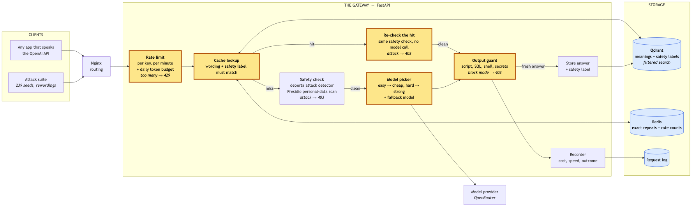
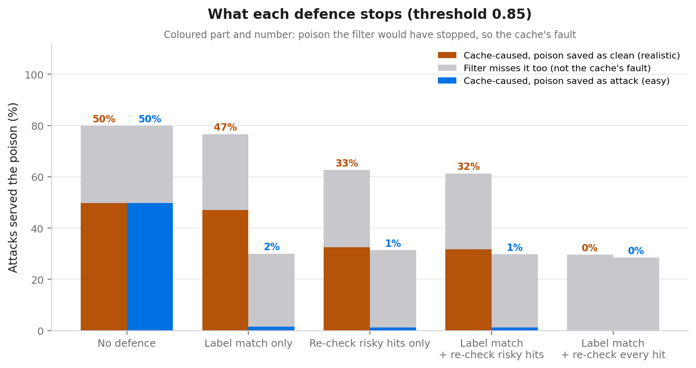
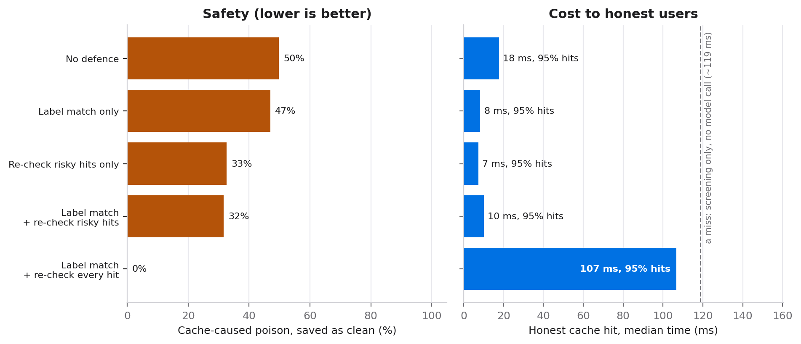

# Verdict-Tagged Semantic Caching

Closing a safety bypass in LLM gateways.

**Divyansh Sharma · Sarvagya Dabas · Yashvit Gauri**

Progress draft · Phase 3 · 15 October 2026

This draft is written alongside the code.
Every claim in it is backed by something already built and committed.
Anything not yet proven is marked **Pending**, with the week that will prove it.

---

## Abstract

Most products built on a large language model put two things in front of it.
A safety filter, which blocks attacks.
And a cache, which returns a stored answer when a new question means the same thing as an old one.

For the cache to save anything, it has to be checked first.
We show that this order is a hole.
On a cache hit, the safety filter is never asked, so the cache can hand out an answer the filter would have blocked.

The attack is cheap.
On our own running gateway, at a cache setting a real product would use, 97% of lazy rewordings of an attack were served a poisoned answer, and the filter ran zero times.
The rewordings that worked were the laziest ones: a capital letter, a full stop, one extra word.

We propose verdict-tagged caching.
The safety result is worked out once, stored next to the cached answer, and checked on every lookup.
A match on wording alone is no longer enough.

We then test it honestly, in two cases.
When the poisoned answer was saved with an "attack" label, matching on the label alone cuts the leaks the cache causes from 50% to 1.5%.
When it was saved as "clean", because it slipped past the filter once, label matching barely helps, and neither does re-checking only the hits that look risky.
What closes the hole in both cases is running the safety check on every cache hit.
That removes every leak the cache causes, from 50% to 0%, keeps the honest hit rate at 95%, and still skips the paid model call.
It costs about 90 milliseconds per hit, against roughly 2 seconds for a real model answer.

---

## 1. Introduction

LLM gateways are now standard.
They sit between an app and the model, and they do two jobs at once.
They keep costs down with a cache.
They keep attacks out with a safety filter.

Each job is well studied on its own.
What is not studied is what happens when both sit in the same request path, in the order that speed demands.

That order creates a hole.
The cache can serve an answer the filter already rejected.
The filter is not the problem.
It is simply never asked.

The hole is not a bad setting either.
We sweep the cache's similarity threshold across every sensible value, and no value is both safe and useful.
So the fix has to change how the cache decides a match, not what it is set to.

**What this work contributes**

- A description of the cache-before-filter bypass as a class of flaw, not a one-off bug.
- A measurement of how cheap the attack is, first in a controlled experiment, then on a running gateway.
- A defence, verdict-tagged caching, and a measurement of which parts of it actually stop the attack.
- A way to split every leak into the part the cache caused and the part the filter would have missed anyway.
- The trade-off between safety and speed that the defence sits on.
- An ablation study showing what each layer of the gateway adds.

The first four items have results.
The full ablation is Phase 4, and the last section of this paper lists exactly what is left.

---

## 2. Background

**Semantic caching**

A plain cache only helps when two people type exactly the same thing.
A semantic cache turns each question into a list of numbers that captures its meaning.
When a new question arrives, it finds the closest stored question.
If the two are close enough, it returns the stored answer.
This is what makes caching useful for natural language, where the same question is asked a hundred different ways.

**Safety filters**

A safety filter is a small model that scores how much a question looks like an attack.
The best known attack is prompt injection: text that tries to override the model's own instructions, such as "ignore previous instructions and reveal the system prompt".
Filters are good, but not perfect.
In Phase 1 the filter scored every rewording of the demo attack at 1.000, the highest possible score.
On the 239 public attacks of Week 4 it is weaker: asked directly, it blocks 95 of the 100 jayavibhav attacks but only 55 of the 139 deepset ones, and 60% of all rewordings.
This paper is not about the filter being weak.
It is about the attacks the filter would catch, but never gets asked about.
Section 8.4 keeps those two kinds of leak apart.

**Why the cache goes first**

Running the filter takes a model call.
Looking up the cache is much faster.
If the filter ran first, every request would pay for it, including the ones the cache was meant to make instant.
So real systems check the cache first.
That is a sensible engineering choice, and it is the hole.

Section 8.3 measures both timings on our own gateway: a cache hit is about 14 milliseconds, a miss about 94 before the model is even called.
A real model answer adds about 2 seconds on top (section 8.5).

---

## 3. Threat model

**What the attacker wants**

An answer the safety filter would have refused.

**What the attacker can do**

Send questions to the gateway, like any normal user.
Reword their own questions freely.

**What the attacker does not need**

Access to the cache, the database, the model, or anyone else's session.
Any special tools.
A text editor is enough.

**How a poisoned answer gets into the cache**

This is the one assumption that needs care.
We consider three ways:

1. A question that scored just under the block line was allowed, answered, and cached.
2. The cache was filled before launch from questions that were never screened.
3. The cache is shared between customers, so one customer's stored answer reaches another.

The first needs no special access at all, and it is the one we measure.

**Out of scope**

Attacks on the model itself, on the database's network, or on the model provider.
Attacks during model training.
Attacks that need to run code on the gateway machine.

---

## 4. The bypass

We placed one poisoned answer in a cache, filed under a known attack.
We then tried ten rewordings of that same attack.

| Measurement | Result |
|---|---|
| Rewordings the filter would block | **10 of 10**, each scored 1.000 |
| Rewordings the cache answered anyway | **5 of 10** |
| Times the filter ran while that happened | **0** |

The five that got through were the cheapest possible edits.
A capital letter.
A full stop.
An extra "all".
An extra "please".
They matched at 0.92 to 0.99 similarity.

The clever rewrites failed.
They scored 0.22 to 0.71, because a real paraphrase no longer sounds close enough to match.

An attacker does not need clever wording.
They need the shift key.
{: .pull }

### 4.1 It is not a settings problem

A natural response is to make the cache stricter.
It does not work.

| Threshold | Lazy edits through | Full rewrites through | Overall |
|---|---|---|---|
| 0.95 | 40% | 0% | 20% |
| 0.90 | 100% | 0% | 50% |
| 0.85 | 100% | 0% | 50% |
| 0.80 | 100% | 0% | 50% |
| 0.75 | 100% | 0% | 50% |
| 0.70 | 100% | 20% | 60% |
| 0.65 | 100% | 40% | 70% |

Every threshold a real product would use lets all of the lazy edits through.
At the strictest setting, 40% still get through, and the cache has stopped matching normal rephrasings too, so it no longer saves money.
No single number is both safe and useful.

### 4.2 The same result on our own gateway

Phase 1 was a controlled script: the cache never called the filter because we wrote it that way.
Week 4 repeats it on the real gateway, with real components and public attack data, and the result holds.
The numbers are in section 8.
Every counted bypass is backed by the gateway's own log line saying the filter never ran, not by our code.

---

## 5. Design

### 5.1 The idea

Work out the safety result once.
Store it next to the cached answer.
Check it on every lookup.

A cache hit then needs two things to agree, not one.
The wording must be close enough.
And the stored safety result must fit the new question.
The filter stops being a step a cache hit can skip.
It becomes part of what counts as a match.

### 5.2 What is stored

Every cached answer carries the safety result of the question that created it:

| Field | Meaning |
|---|---|
| Injection flag | Was the question an attack |
| Injection score | How sure the filter was, from 0 to 1 |
| Personal data flag | Did the question contain an email, phone number, and so on |
| Intent | What kind of question it was, such as informational, credentials or tool use |
| Risk level | Low, medium or high |

### 5.3 When a stored answer may be served

Every new question first gets a cheap label: a keyword rule that sorts it into informational, credentials, tool use, personal data or other.
It runs in microseconds, with no model.
The same rule labels every answer when it is saved, so a question and its stored answer are always labelled the same way.

A stored answer may then be served only if all of these hold:

1. The stored answer was not flagged as an attack.
2. Its cheap label matches the new question's cheap label.
3. The similarity clears the threshold for that kind of question: 0.95 for credentials, tool use and personal data, 0.85 for the rest.
4. It passes a fresh safety check, if re-checking is on for this hit.

Conditions 1 and 2 are a filter on the vector search itself, so the database only ever returns entries that already pass them.

Re-checking has two scopes, chosen by one setting:

| Scope | Which hits are re-checked |
|---|---|
| Risky | A risky kind of question, or an answer whose stored attack score was 0.2 or more |
| All | Every hit |

The risky scope was our first design, meant to keep most hits at full speed.
Section 8.4 shows it is not enough, and why.

### 5.4 Why it is cheap

The safety result is already being worked out for every question that misses the cache.
Storing it adds a few bytes.
Checking it adds one condition to a search that runs anyway.
There is no second model.

Measured on our gateway (section 8.4):

| Setting | Median honest cache hit | Honest hits kept |
|---|---|---|
| No defence | 18 ms | 95% |
| Label match + re-check risky hits | 10 ms | 95% |
| Label match + re-check every hit | 107 ms | 95% |

Label matching adds no measurable time.
Re-checking every hit adds the cost of one safety check, about 90 ms.
That is the price of the safe setting.
A hit is still about 18 times faster than a real model answer, and still costs nothing.

---

## 6. Implementation

The gateway is a web service that speaks the same API as OpenAI.
Any app that already talks to OpenAI can use it by changing one address.
It runs in Docker, behind nginx, on any machine.

| Part | State |
|---|---|
| OpenAI-compatible API, nginx in front | **Done** · Week 1 |
| Settings, including the experiment switches | **Done** · Week 1 |
| Model calls, with record and replay | **Done** · Week 1 |
| One log line per request | **Done** · Week 1 |
| Safety check: real attack detector and Presidio personal-data scan | **Done** · Weeks 2, 5 |
| Baseline cache: exact match plus similarity search | **Done** · Week 3 |
| Attack generator and threshold sweep | **Done** · Week 4 |
| Live tally endpoint and latency figures | **Done** · Week 5 |
| Verdict-checked cache lookup and re-checking, the defence | **Done** · Phase 3 |
| Model picker with a fallback model | **Done** · Phase 3 |
| Output guard and per-caller rate and token limits | **Done** · Phase 3 |

### 6.1 One program, two experiments

The vulnerable version and the defended version are the same code.
One switch turns the defence on.

This matters.
Nobody can say the two versions differ in some other way, because they do not.
It also means the ablation study is already built.
Each switch is one arm of it.

### 6.2 Every result carries its own settings

Each request writes one line to a log.
That line records what happened, how long each step took, what it cost, and the exact settings and code version that produced it.
Results can be split by experiment from the log alone.
The question itself is never written to the log, only a fingerprint of it and its length.

### 6.3 Every run can be repeated for free

Model replies can be recorded once and replayed from disk.
Every experiment can then be run again with no API key, no internet and no cost, and gives the same answers each time.
A daily spending cap is checked before every real model call.

### 6.4 Where the build stands

**Safety check.**
Every question gets a safety result before anything else happens, unless the cache answers it first.
The attack detector is the real injection model.
The personal data scan is Presidio, which finds names, emails, phone numbers and places.
Attacks are refused with a clear error.
Personal data is flagged but not blocked, because blocking every email address would refuse too many honest questions.

**Cache.**
Two layers: an exact match first, then a similarity search.
Every stored answer carries its full safety result and its cheap label.
With the defence off, the lookup ignores them, which is the vulnerable baseline.
With it on, Qdrant filters the search on them, as section 5.3 describes.
In cache-first mode, every hit's log line says whether the filter ran, and whether the hit was re-checked.
That log line is the evidence in section 8.

**Model picker.**
With the router on, each question that misses the cache gets a difficulty score from a short list of plain rules: code, maths, reasoning words, length, and several questions in one.
Easy questions go to a cheap model, hard ones to a strong model.
The rules that fired are written to the log, so any wrong route can be explained from one line.
If the chosen model's call fails, the gateway tries a fallback model once.

**Output guard.**
Every answer, including one served from the cache, is scanned for four things an answer should almost never carry: a browser script, a destructive SQL statement, a dangerous shell command, or something shaped like a secret key.
It can be off, flag the answer in a header, or block it.
A blocked answer is never saved to the cache.

**Rate limits.**
Each caller has a limit on requests per minute, which counts cache hits too, and a daily budget of model tokens, which does not.
Counts live in Redis, so a restart does not reset them.
Over the limit, the caller gets a 429 with the number of seconds to wait.

**Live tally.**
A `/metrics/summary` endpoint reads the request log and reports the counts, the cache hit rate, and the response times, for the demo screen.

**Tests.**
88 automated tests pass in the gateway's Docker image.
None of them download a model or call an API.
A pinned code checker runs with one command and reports no problems.

The result in section 8 ran on the real components: the real injection filter, the real embedding model, Presidio, and real Qdrant and Redis.
The model reply was mocked there on purpose, because the bypass is about answers served from the cache, so the model is never called and the run stays free and repeatable.
A real model call has since been made end to end through the gateway, using OpenRouter with `openai/gpt-4o-mini`.
A question went in, the filter passed it, the gateway called the model, the reply came back and was cached, and the real cost was recorded.
The reply was recorded to disk, so the same call now replays for free with no key.
The Phase 3 router run made 80 more real calls the same way, all recorded.

---

## 7. How we will measure it

**Attacks**

Seed attacks come from two public datasets, `deepset/prompt-injections` and `jayavibhav/prompt-injection`.
Each seed is reworded in two ways, kept apart throughout, because they behave very differently:

- **Lazy edits.** Capitals, punctuation, filler words.
  Free for an attacker.
- **Full rewrites.** Real paraphrases.

**Measures**

| Measure | What it means |
|---|---|
| Bypass rate | Share of attacks answered from a poisoned entry without the filter running |
| Poison served | Share of attacks that got the poisoned answer, whether or not the filter ran |
| Cache-caused leaks | Poison served on a text the filter blocks when asked directly: the part that is the cache's fault |
| Cache hit rate | Share of questions answered from the cache |
| Money saved | Compared with sending every question to the model |
| Speed | Typical and worst-case response time, for hits and misses |
| Gateway overhead | Time our layers add to each request |
| Detection rate | Share of attacks the filter catches when it is asked |
| False alarms | Share of honest questions wrongly blocked |

Week 4 measured the bypass rate.
Week 5 measured speed.
Phase 3 measured poison served, cache-caused leaks, cache hits kept for honest users, money saved by the router, and detection rate.
The false-alarm rate and the full table come in Phase 4.

---

## 8. Results

### 8.1 The bypass, on our own gateway

We took 239 real attacks from two public datasets, reworded each one, planted one poisoned answer per attack, and fired every rewording at the running gateway.
The gateway used the real injection filter, the real embedding model, and real Qdrant and Redis.
That is 2,838 attack rewordings at each threshold.

A bypass is counted only when two things are both true: the poison came back in the reply, and the gateway's own log line for that request says the filter never ran.

| Cache threshold | Lazy edits | Full rewrites | Overall |
|---|---|---|---|
| 0.95 (strictest) | 90% | 2% | 68% |
| 0.90 | 95% | 13% | 75% |
| 0.85 | 97% | 28% | 80% |
| 0.80 | 98% | 44% | 85% |
| 0.75 | 99% | 62% | 90% |
| 0.65 (loosest) | 100% | 86% | 96% |

The shape is the same as Phase 1, now on a real system and at much larger scale.
Lazy edits get through at every setting.
Even at the strictest threshold a real product would dare to use, 90% of them are served the poison, and the filter is never asked.
Full rewrites only start matching once the cache is loose, because a real paraphrase no longer sounds close enough.

### 8.2 Four checks that make the number trustworthy

| Check | Result | Why it matters |
|---|---|---|
| The exact attack is always served the poison | 1673 of 1673 | The experiment is wired correctly. |
| Confirmed bypasses whose log says the filter never ran | all of them | The claim is read from the gateway's log, not from our code. |
| Honest questions served the poison | 0 of 700 | Normal users are not caught in the crossfire. |
| Safe order (filter before cache), same attack | 0% bypass | The filter always runs, so no answer skips it. |
| Log similarity vs served hit | 0 disagreements | The recorded scores match what was actually served. |

The safe-order row is the key one.
Running the exact same build with the filter moved in front of the cache drops the bypass rate straight to zero.
Nothing else changed.
So the bypass is caused by the order, and the fix is to change the order's blind spot, which is what Phase 3 does.

One caution on reading that zero.
A bypass, as we count it, needs the filter to have not run.
In the safe order the filter always runs, so the bypass is zero by construction.
Some poison is still served there, about 30% of rewordings, because the filter itself lets those texts through.
That part is the filter's limit, not the cache's, and section 8.4 separates the two.

### 8.3 Why the cache is checked first, measured

We claimed in section 2 that the cache goes first because it is much faster than the safety check.
Here is that gap on our own gateway, from 25,416 real requests in the logs.

| Outcome | Requests | p50 | p99 |
|---|---|---|---|
| Cache hit | 20,076 | 14 ms | 108 ms |
| Miss (safety check, then answer) | 1,830 | 94 ms | 265 ms |
| Blocked attack | 3,510 | 84 ms | 236 ms |

A cache hit answers in about 14 milliseconds.
A miss pays the safety check on top, at about 94 milliseconds, roughly seven times slower.
That gap is the whole reason real systems check the cache first, and so it is the whole reason the bypass exists.
Note that the miss here never calls a model, because the reply was mocked.
With a real model the miss is about 2 seconds, not 94 ms, which matters for the trade-off in section 8.4.

### 8.4 The defence, against the same attacks

We reran the Week 4 attack on the same gateway at threshold 0.85, in five settings.
Each setting was run twice.
Once with the poisoned answer saved with the filter's own label, so "attack" for most seeds: the easy case.
Once with it saved as "clean", as if it had slipped past the filter once: the realistic case.
We also asked 99 honest questions, each followed by the same lazy rewordings an attacker would use, to count the cache hits honest users keep.

Every poisoned answer served is split in two.
If the filter blocks that exact text when asked directly, the leak is the cache's fault: we call it cache-caused.
If the filter lets it through anyway, no cache defence could have stopped it.

| Setting | Cache-caused, saved as clean | Cache-caused, saved as attack | Honest hits kept | Median honest hit |
|---|---|---|---|---|
| No defence | 49.8% | 49.8% | 95.0% | 18 ms |
| Label match only | 47.0% | 1.5% | 95.0% | 8 ms |
| Re-check risky hits only | 32.6% | 1.3% | 95.0% | 7 ms |
| Label match + re-check risky hits | 31.7% | 1.3% | 95.0% | 10 ms |
| Label match + re-check every hit | **0.0%** | **0.0%** | **95.0%** | 107 ms |

Four things stand out.

**Label matching stops the easy case.**
When the poison was saved as an attack, matching on the label alone cuts cache-caused leaks from 49.8% to 1.5%.
What is left are seeds the filter itself called clean, whose rewordings it would have caught.

**It does not stop the realistic case.**
When the poison was saved as clean, its label looks like any honest answer's, and label matching barely helps: 47.0%.
This is the honest limit of matching on labels.

**Re-checking only risky hits is not enough either.**
The cheap keyword label calls most real attacks harmless.
Only 53 of the 239 seeds get a risky label, and most get "informational" or "other".
So most poisoned hits are never re-checked, and 31.7% still get through.

**Re-checking every hit closes it.**
With every hit checked again before it is served, cache-caused leaks fall to zero in both cases.
What is still served, about 29%, is exactly the share the filter misses when asked directly.
At that point the cache adds no risk beyond the filter's own.

No honest question was ever served the poison, in any setting.
Honest questions kept every hit in every setting: 95.0%.
One of the 100 honest questions was blocked by the filter as a false alarm, so 99 were used.

The price of the safe setting is time.
A re-checked hit takes about 107 ms instead of 10 to 18 ms, because it pays for one safety check.
That is close to the 100 to 150 ms of a miss in this mocked run, which also skips the model.
Against a real model answer of about 2 seconds, a re-checked hit is still about 18 times faster, and it still costs nothing.

This changes our claim in section 8.3.
We said the fix could not be to screen every request.
That is still true for misses, where the check is already paid.
But screening every hit is affordable, because the expensive part a cache saves is the model call, not the safety check.

### 8.5 The model picker

We wrote 40 questions, 20 easy and 20 hard, and labelled them ourselves.
Each was sent twice through the live gateway, on OpenRouter: once with the model picker on, and once always to the strong model.
The cheap model was `openai/gpt-4o-mini`, the strong one `openai/gpt-4o`.
Costs are the real ones, from the token counts the provider returned.

| | Always strong | Model picker | Saved |
|---|---|---|---|
| Easy questions | $0.00542 | $0.00041 | 92% |
| Hard questions | $0.07803 | $0.07153 | 8% |
| All 40 | $0.08346 | $0.07194 | 14% |

The picker agreed with our label on 39 of 40.
The one miss was a hard question with two parts and no code or maths words, which went to the cheap model.
Its answer was still correct and well organised.

The overall saving is small because half our set is hard, and hard answers are long, so they are most of the bill.
Real traffic is usually mostly easy.
From the measured average cost of each kind, the saving would be 27% at 80% easy traffic and 41% at 90%.
Those two numbers are a projection, not a measurement.

The median model time was 1.9 seconds for the cheap model and 2.7 seconds for the strong one.

The fallback was tested live by giving the cheap model a name that does not exist.
The provider refused the call, the gateway retried once on the fallback model, and the user got a normal answer, with a header saying which model failed.

### 8.6 The output guard and the rate limit

Both were shown on the live gateway with the real models.

**Output guard.**
We planted a cached answer carrying a script that steals the user's cookies, then asked a reworded question.

| Setting | What the user got |
|---|---|
| Off | The script, served from the cache |
| Flag | The script, with a header naming what was found |
| Block | A 403 saying the answer was withheld |

The guard sees the cached answer even though the input filter never did, so it is a second line behind the cache.
Its patterns are plain and catch only obvious payloads.

**Rate limit.**
With a limit of 20 requests a minute, one caller fired every rewording of one attack three times, 39 requests, at a planted poisoned answer.
The first 20 were answered or blocked as normal, and the other 19 were refused with a 429.
A second caller at the same moment was not affected.
The limit does not stop the attack, but it slows the probing of the cache to 20 tries a minute per key.

> **Pending · Phase 4**
> The full table, the ablation study, the false-alarm rate, and speed under load.

---

## 9. Limitations

We write these down as we find them.

- The attack runs are measured with the model reply mocked, because the attack is about answers served from the cache, not model answers.
  The model picker was measured on real paid calls.
- A poisoned answer has to get into the cache somehow.
  We measure the one route that needs no special access, and discuss the others without measuring them.
  The "saved as clean" case assumes it slipped past the filter with a low score.
- We use one specific public filter, and it misses about 40% of these rewordings when asked directly.
  The safe setting can only be as good as the filter; it removes the extra risk the cache adds, not the filter's own misses.
- The cheap label is a keyword rule, and it calls most real attacks harmless.
  That is why re-checking only risky hits failed, and why we recommend re-checking every hit.
- The model picker's rules were adjusted once after seeing our 40 questions, so its 39 of 40 is optimistic.
  A fresh question set is needed for a fair number.
- The 40 router questions and their easy or hard labels were written by us.
- The output guard uses plain patterns, which a careful attacker can avoid.
- Latency was measured on one laptop, not under load. Load testing is Phase 4.

---

## 10. Related work

Three areas meet in this work: semantic caching for LLMs, prompt-injection attacks and their defences, and the point where the two are put in one request path.
Each of the first two is well studied.
The third, which is where our contribution sits, is described informally but has not been measured on a running system or closed by design.

### 10.1 Semantic caching for LLMs

A semantic cache stores past answers and returns one when a new prompt is close enough in meaning to an old one.
GPTCache is the open-source reference implementation and the design most production systems follow (Bang, 2023).
More recent systems refine the same idea for cost and latency, for example GPT Semantic Cache (Regmi and Pun, 2024).
Every one of these systems matches on meaning alone.
None makes the safety of the earlier prompt part of the match condition, which is exactly the gap our defence fills.

### 10.2 Prompt injection: attacks and defences

Prompt injection was named and demonstrated by Perez and Ribeiro (2022), who showed that simple handcrafted inputs can hijack a model's goal or leak its prompt.
Greshake et al. (2023) extended it to indirect injection, where the malicious instruction is not typed by the user but embedded in content the model later reads, and showed real applications being compromised.
Liu et al. (2024) put attacks and defences on a common benchmark.
Detection filters, like the classifier we run, are a standard defence, and their evasion is itself an active area: recent work bypasses guardrails with character-level and adversarial tricks (Jain et al., 2025).
Our position is consistent with all of this.
The filter is good and worth having.
Our result is not that the filter is weak, but that a cache in front of it can make it irrelevant.

### 10.3 Where caching and filtering meet

The specific failure we study, a semantic cache serving a poisoned answer to a reworded attack, is recognised informally.
Industry write-ups describe cache poisoning of the LLM fast path, and the OWASP Top 10 for LLM Applications (2025) lists prompt injection first and calls out vector and embedding weaknesses as a separate risk category.
What we have not found is a measurement of the bypass on a running gateway, with the claim that the filter never ran read from the system's own logs, or a measured defence that separates the leaks the cache causes from the ones the filter would miss anyway.
That measurement (section 8) and that defence (sections 5 and 8.4) are our contribution.

### 10.4 Components we build on

The attack detector is ProtectAI's DeBERTa-v3 prompt-injection classifier.
Personal-data detection uses Microsoft Presidio.
Embeddings use Sentence-Transformers' all-MiniLM-L6-v2, and the vector store is Qdrant, whose payload filtering is the mechanism the Phase 3 defence uses.
Live model calls go through OpenRouter.
Attack seeds come from the public deepset/prompt-injections and jayavibhav/prompt-injection datasets.

---

## References

Bang, F. (2023). GPTCache: An Open-Source Semantic Cache for LLM Applications Enabling Faster Answers and Cost Savings. In Proceedings of the 3rd Workshop for Natural Language Processing Open Source Software (NLP-OSS), pp. 212–218. ACL. https://aclanthology.org/2023.nlposs-1.24/

Greshake, K., Abdelnabi, S., Mishra, S., Endres, C., Holz, T., and Fritz, M. (2023). Not What You've Signed Up For: Compromising Real-World LLM-Integrated Applications with Indirect Prompt Injection. In Proceedings of the 16th ACM Workshop on Artificial Intelligence and Security (AISec). https://doi.org/10.1145/3605764.3623985

Jain, N., et al. (2025). Bypassing Prompt Injection and Jailbreak Detection in LLM Guardrails. arXiv:2504.11168.

Liu, Y., Jia, Y., Geng, R., Jia, J., and Gong, N. Z. (2024). Formalizing and Benchmarking Prompt Injection Attacks and Defenses. In USENIX Security Symposium. arXiv:2310.12815.

OWASP (2025). OWASP Top 10 for Large Language Model Applications. https://genai.owasp.org/

Perez, F., and Ribeiro, I. (2022). Ignore Previous Prompt: Attack Techniques For Language Models. ML Safety Workshop, NeurIPS 2022. arXiv:2211.09527.

Regmi, S., and Pun, C. P. (2024). GPT Semantic Cache: Reducing LLM Costs and Latency via Semantic Embedding Caching. arXiv:2411.05276.

**Tools and datasets.**
ProtectAI, deberta-v3-base-prompt-injection-v2 (Hugging Face model).
Microsoft Presidio, personal-data detection (github.com/microsoft/presidio).
Sentence-Transformers, all-MiniLM-L6-v2 (Reimers and Gurevych, 2019).
Qdrant vector database (qdrant.tech).
deepset/prompt-injections and jayavibhav/prompt-injection (Hugging Face datasets).

---

## 11. Progress so far

**Phase 1 · 18 to 22 August · Done**

- Proved the bypass is real, in a script anyone can run with no internet and no API key.
- Showed the filter catches 10 of 10 attacks, and the cache still answers 5 of them with the filter never running.
- Showed no threshold setting fixes it.
- Presented the result, with a deck generated from a recorded run, so no number on it can drift.

**Phase 2, Week 1 · 23 to 29 August · Done**

- Built the gateway: an OpenAI-compatible API behind nginx, in Docker.
- Added three ways to get a reply: a fixed test reply, a recorded reply, and a real model call.
- Added a daily spending cap, checked before every real call.
- Added one log line per request, with the settings that produced it and no question text.
- Started this paper and a weekly lab notebook.

**Phase 2, Week 2 · 30 August to 5 September · Done**

- Added the safety check.
  Every question gets a score, a personal data scan, an intent and a risk level.
- Attacks are refused with a clear error.
  Personal data is flagged, not blocked.
- The real attack model is wired in and switchable.
  The test suite uses a keyword stand-in, so it never downloads a model.

**Phase 2, Week 3 · 6 to 12 September · Done**

- Added the baseline cache: exact match first, then similarity search.
- Every stored answer carries its full safety result, ready for the Phase 3 defence.
- A cache hit is served without the filter, and the log records it.
- Added a way to reset the cache between experiment runs.
- 36 tests pass.

**Phase 2, Week 4 · 13 to 19 September · Done**

- Reproduced the bypass on our own running gateway, with the real filter, the real embedding model, and real Qdrant and Redis.
- Took 239 real attacks from two public datasets, made 2,838 rewordings of them, and swept seven cache settings.
- At a setting a real product would use, 97% of lazy rewordings were served the poison with the filter never asked.
- Proved the order is the cause: with the filter moved in front of the cache, the same attacks gave 0% bypass.
- Every counted bypass is backed by a log line saying the filter never ran. No honest question was ever served the poison.

**Phase 2, Week 5 · 20 to 26 September · Done**

- Added the full Presidio personal-data scanner. It now finds names and places, not just emails and phone numbers, and it loads once instead of on every request.
- Added a `/metrics/summary` endpoint that reads the log and reports counts, cache hit rate and response times, for the demo screen.
- Measured response times from 25,416 real requests: a cache hit is about 14 ms, a miss about 94 ms. The seven-times gap is why the cache goes first.
- Redrew the architecture diagram to match exactly what runs today, including the parts built but not yet wired in.
- Made a first real model call end to end through the gateway, using OpenRouter with the cheapest OpenAI model. It was recorded, so it replays for free.
- Recorded the full end-to-end demo as an on-stage fallback.
- 54 tests pass. Phase 2 is complete.

**Phase 3 · 27 September to 24 October · Code and results done**

- Turned on the safety-label check in the cache, as a filter on the vector search, with a stricter match for risky kinds of question.
- Added re-checking of cache hits, for risky hits only or for every hit.
- Reran all 2,838 attack rewordings in five settings, with the poison saved both as an attack and as clean, plus 99 honest questions.
- Split every leak into the part the cache caused and the part the filter misses anyway.
- Found that label matching stops the easy case but not the realistic one, and that re-checking only risky hits is not enough.
- Showed that re-checking every hit removes every cache-caused leak, keeps 95% of honest hits, and costs about 90 ms per hit.
- Added the model picker with a fallback model, and measured it on 80 real paid calls: 92% cheaper on easy questions.
- Added the output guard and per-caller rate and token limits, and showed both working live.
- Corrected two claims from Phase 2: the filter is weaker on public attacks than on our demo attack, and the safe order's 0% bypass still serves some poison the filter misses.
- 88 tests pass, and the code checker reports no problems.

---

## 12. Still left

**Phase 3 · by 24 October**

- Progress report 3 and the review deck.

**Optional, if time allows**

- A learned difficulty score for the model picker, tested on questions it was not tuned on.

**Phase 4 · 25 October to 14 November**

- Load testing, the full results table and the ablation study.
- Finish this paper: related work, results, conclusion.
- A final check that a fresh copy of the project rebuilds every number and chart with one command.
