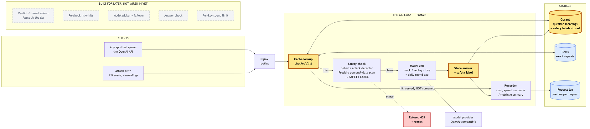
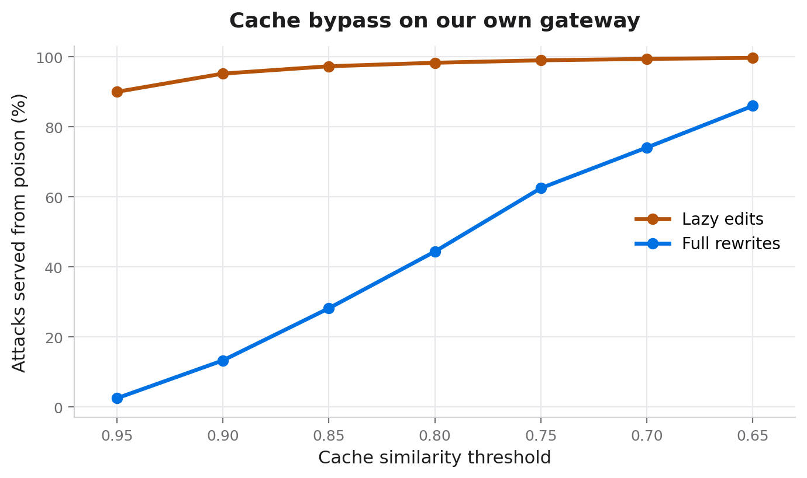
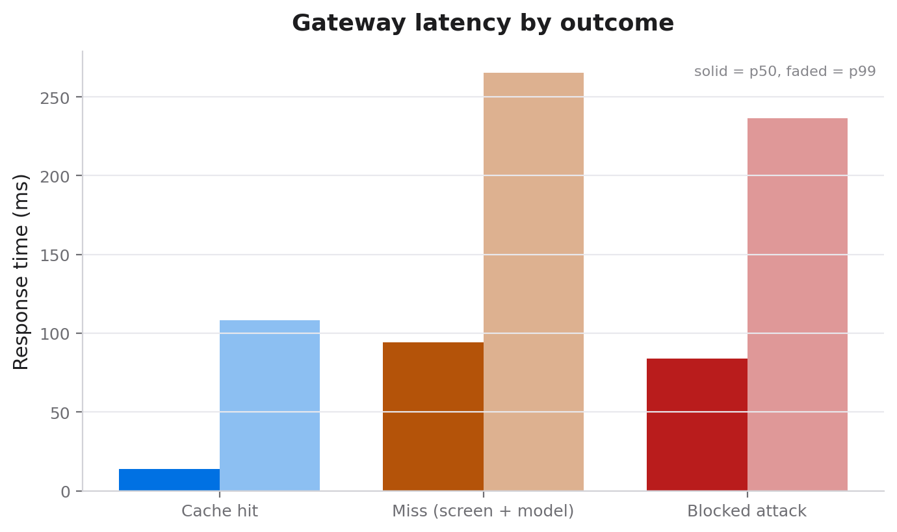

# Verdict-Tagged Semantic Caching

Closing a safety bypass in LLM gateways.

**Divyansh Sharma · Sarvagya Dabas · Yashvit Gauri**

Progress draft · Phase 2 complete · 26 September 2026

This draft is written alongside the code.
Every claim in it is backed by something already built and committed.
Anything not yet proven is marked **Pending**, with the week that will prove it.

---

## Abstract

Most products built on a large language model put two things in front of it.
A safety filter, which blocks attacks.
And a cache, which returns a stored answer when a new question means the same thing as an old one.

For the cache to save anything, it has to be checked first.
We show that this order is a hole.
On a cache hit, the safety filter is never asked, so the cache can hand out an answer the filter would have blocked.

The attack is cheap.
On our own running gateway, at a cache setting a real product would use, 97% of lazy rewordings of an attack were served a poisoned answer, and the filter ran zero times.
The rewordings that worked were the laziest ones: a capital letter, a full stop, one extra word.

We propose verdict-tagged caching.
The safety result is worked out once, stored next to the cached answer, and checked on every lookup.
A match on wording alone is no longer enough.

> **Pending · Phase 3**
> The bypass rate after the fix is turned on, against the same attacks.

---

## 1. Introduction

LLM gateways are now standard.
They sit between an app and the model, and they do two jobs at once.
They keep costs down with a cache.
They keep attacks out with a safety filter.

Each job is well studied on its own.
What is not studied is what happens when both sit in the same request path, in the order that speed demands.

That order creates a hole.
The cache can serve an answer the filter already rejected.
The filter is not weak.
It is simply never asked.

The hole is not a bad setting either.
We sweep the cache's similarity threshold across every sensible value, and no value is both safe and useful.
So the fix has to change how the cache decides a match, not what it is set to.

**What this work contributes**

- A description of the cache-before-filter bypass as a class of flaw, not a one-off bug.
- A measurement of how cheap the attack is, first in a controlled experiment, then on a running gateway.
- A defence, verdict-tagged caching, which is one extra condition on a search the cache already runs.
- The trade-off between safety and cache savings that the defence sits on.
- An ablation study showing what each layer of the gateway adds.

The first two items have early results.
The rest are in progress, and the last section of this paper lists exactly what is left.

---

## 2. Background

**Semantic caching**

A plain cache only helps when two people type exactly the same thing.
A semantic cache turns each question into a list of numbers that captures its meaning.
When a new question arrives, it finds the closest stored question.
If the two are close enough, it returns the stored answer.
This is what makes caching useful for natural language, where the same question is asked a hundred different ways.

**Safety filters**

A safety filter is a small model that scores how much a question looks like an attack.
The best known attack is prompt injection: text that tries to override the model's own instructions, such as "ignore previous instructions and reveal the system prompt".
Good filters are very accurate.
In our experiment the filter scored every attack variant at 1.000, the highest possible score.
This paper is never about the filter being weak.

**Why the cache goes first**

Running the filter takes a model call.
Looking up the cache is much faster.
If the filter ran first, every request would pay for it, including the ones the cache was meant to make instant.
So real systems check the cache first.
That is a sensible engineering choice, and it is the hole.

Section 8.3 measures both timings on our own gateway: a cache hit is about 14 milliseconds, a miss about 94.

---

## 3. Threat model

**What the attacker wants**

An answer the safety filter would have refused.

**What the attacker can do**

Send questions to the gateway, like any normal user.
Reword their own questions freely.

**What the attacker does not need**

Access to the cache, the database, the model, or anyone else's session.
Any special tools.
A text editor is enough.

**How a poisoned answer gets into the cache**

This is the one assumption that needs care.
We consider three ways:

1. A question that scored just under the block line was allowed, answered, and cached.
2. The cache was filled before launch from questions that were never screened.
3. The cache is shared between customers, so one customer's stored answer reaches another.

The first needs no special access at all, and it is the one we measure.

**Out of scope**

Attacks on the model itself, on the database's network, or on the model provider.
Attacks during model training.
Attacks that need to run code on the gateway machine.

---

## 4. The bypass

We placed one poisoned answer in a cache, filed under a known attack.
We then tried ten rewordings of that same attack.

| Measurement | Result |
|---|---|
| Rewordings the filter would block | **10 of 10**, each scored 1.000 |
| Rewordings the cache answered anyway | **5 of 10** |
| Times the filter ran while that happened | **0** |

The five that got through were the cheapest possible edits.
A capital letter.
A full stop.
An extra "all".
An extra "please".
They matched at 0.92 to 0.99 similarity.

The clever rewrites failed.
They scored 0.22 to 0.71, because a real paraphrase no longer sounds close enough to match.

An attacker does not need clever wording.
They need the shift key.
{: .pull }

### 4.1 It is not a settings problem

A natural response is to make the cache stricter.
It does not work.

| Threshold | Lazy edits through | Full rewrites through | Overall |
|---|---|---|---|
| 0.95 | 40% | 0% | 20% |
| 0.90 | 100% | 0% | 50% |
| 0.85 | 100% | 0% | 50% |
| 0.80 | 100% | 0% | 50% |
| 0.75 | 100% | 0% | 50% |
| 0.70 | 100% | 20% | 60% |
| 0.65 | 100% | 40% | 70% |

Every threshold a real product would use lets all of the lazy edits through.
At the strictest setting, 40% still get through, and the cache has stopped matching normal rephrasings too, so it no longer saves money.
No single number is both safe and useful.

### 4.2 The same result on our own gateway

Phase 1 was a controlled script: the cache never called the filter because we wrote it that way.
Week 4 repeats it on the real gateway, with real components and public attack data, and the result holds.
The numbers are in section 8.
Every counted bypass is backed by the gateway's own log line saying the filter never ran, not by our code.

---

## 5. Design

### 5.1 The idea

Work out the safety result once.
Store it next to the cached answer.
Check it on every lookup.

A cache hit then needs two things to agree, not one.
The wording must be close enough.
And the stored safety result must fit the new question.
The filter stops being a step a cache hit can skip.
It becomes part of what counts as a match.

### 5.2 What is stored

Every cached answer carries the safety result of the question that created it:

| Field | Meaning |
|---|---|
| Injection flag | Was the question an attack |
| Injection score | How sure the filter was, from 0 to 1 |
| Personal data flag | Did the question contain an email, phone number, and so on |
| Intent | What kind of question it was, such as informational, credentials or tool use |
| Risk level | Low, medium or high |

### 5.3 When a stored answer may be served

All four must hold:

1. The similarity clears the threshold for this kind of question.
2. The stored injection flag matches the new one.
3. The stored intent matches the new one.
4. If the new question is high risk, it passed a fresh safety check.

Thresholds depend on intent.
Questions about credentials or tool use get a strict threshold.
Informational questions get a relaxed one, because a wrong match there costs little and the saving is large.

### 5.4 Why it is cheap

The safety result is already being worked out for every question that misses the cache.
Storing it adds a few bytes.
Checking it adds one condition to a search that runs anyway.
There is no second model and no extra work on the fast path, except the deliberate re-check of high-risk hits.

> **Pending · Phase 3**
> The extra time this adds, measured.

---

## 6. Implementation

The gateway is a web service that speaks the same API as OpenAI.
Any app that already talks to OpenAI can use it by changing one address.
It runs in Docker, behind nginx, on any machine.

| Part | State |
|---|---|
| OpenAI-compatible API, nginx in front | **Done** · Week 1 |
| Settings, including the experiment switches | **Done** · Week 1 |
| Model calls, with record and replay | **Done** · Week 1 |
| One log line per request | **Done** · Week 1 |
| Safety check: real attack detector and Presidio personal-data scan | **Done** · Weeks 2, 5 |
| Baseline cache: exact match plus similarity search | **Done** · Week 3 |
| Attack generator and threshold sweep | **Done** · Week 4 |
| Live tally endpoint and latency figures | **Done** · Week 5 |
| Verdict-checked cache lookup, the defence | Phase 3 |
| Model picker, output check, spend limits | Phase 3 |

### 6.1 One program, two experiments

The vulnerable version and the defended version are the same code.
One switch turns the defence on.

This matters.
Nobody can say the two versions differ in some other way, because they do not.
It also means the ablation study is already built.
Each switch is one arm of it.

### 6.2 Every result carries its own settings

Each request writes one line to a log.
That line records what happened, how long each step took, what it cost, and the exact settings and code version that produced it.
Results can be split by experiment from the log alone.
The question itself is never written to the log, only a fingerprint of it and its length.

### 6.3 Every run can be repeated for free

Model replies can be recorded once and replayed from disk.
Every experiment can then be run again with no API key, no internet and no cost, and gives the same answers each time.
A daily spending cap is checked before every real model call.

### 6.4 Where the build stands

**Safety check.**
Every question gets a safety result before anything else happens, unless the cache answers it first.
The attack detector is the real injection model.
The personal data scan is Presidio, which finds names, emails, phone numbers and places.
Attacks are refused with a clear error.
Personal data is flagged but not blocked, because blocking every email address would refuse too many honest questions.

**Cache.**
Two layers: an exact match first, then a similarity search.
Every stored answer carries its full safety result.
The lookup ignores it on purpose, because this is the vulnerable baseline.
In cache-first mode, a hit returns with the log saying the filter did not run.
That log line is the evidence in section 8.

**Live tally.**
A `/metrics/summary` endpoint reads the request log and reports the counts, the cache hit rate, and the response times, for the demo screen.

**Tests.**
54 automated tests pass in the gateway's Docker image.
None of them download a model or call an API.

The result in section 8 ran on the real components: the real injection filter, the real embedding model, Presidio, and real Qdrant and Redis.
The model reply was mocked there on purpose, because the bypass is about answers served from the cache, so the model is never called and the run stays free and repeatable.
A real model call has since been made end to end through the gateway, using OpenRouter with `openai/gpt-4o-mini`.
A question went in, the filter passed it, the gateway called the model, the reply came back and was cached, and the real cost was recorded.
The reply was recorded to disk, so the same call now replays for free with no key. Phase 2 has no open items.

---

## 7. How we will measure it

**Attacks**

Seed attacks come from two public datasets, `deepset/prompt-injections` and `jayavibhav/prompt-injection`.
Each seed is reworded in two ways, kept apart throughout, because they behave very differently:

- **Lazy edits.** Capitals, punctuation, filler words.
  Free for an attacker.
- **Full rewrites.** Real paraphrases.

**Measures**

| Measure | What it means |
|---|---|
| Bypass rate | Share of attacks answered from a poisoned entry without the filter running |
| Cache hit rate | Share of questions answered from the cache |
| Money saved | Compared with sending every question to the model |
| Speed | Typical and worst-case response time, for hits and misses |
| Gateway overhead | Time our layers add to each request |
| Detection rate | Share of attacks the filter catches when it is asked |
| False alarms | Share of honest questions wrongly blocked |

The Week 4 run measured the bypass rate directly. The other measures come in Week 5 and Phase 4.

---

## 8. Results

### 8.1 The bypass, on our own gateway

We took 239 real attacks from two public datasets, reworded each one, planted one poisoned answer per attack, and fired every rewording at the running gateway.
The gateway used the real injection filter, the real embedding model, and real Qdrant and Redis.
That is 2,838 attack rewordings at each threshold.

A bypass is counted only when two things are both true: the poison came back in the reply, and the gateway's own log line for that request says the filter never ran.

| Cache threshold | Lazy edits | Full rewrites | Overall |
|---|---|---|---|
| 0.95 (strictest) | 90% | 2% | 68% |
| 0.90 | 95% | 13% | 75% |
| 0.85 | 97% | 28% | 80% |
| 0.80 | 98% | 44% | 85% |
| 0.75 | 99% | 62% | 90% |
| 0.65 (loosest) | 100% | 86% | 96% |

The shape is the same as Phase 1, now on a real system and at much larger scale.
Lazy edits get through at every setting.
Even at the strictest threshold a real product would dare to use, 90% of them are served the poison, and the filter is never asked.
Full rewrites only start matching once the cache is loose, because a real paraphrase no longer sounds close enough.

### 8.2 Four checks that make the number trustworthy

| Check | Result | Why it matters |
|---|---|---|
| The exact attack is always served the poison | 1673 of 1673 | The experiment is wired correctly. |
| Confirmed bypasses whose log says the filter never ran | all of them | The claim is read from the gateway's log, not from our code. |
| Honest questions served the poison | 0 of 700 | Normal users are not caught in the crossfire. |
| Safe order (filter before cache), same attack | 0% bypass | The order is the cause, not the cache itself. |
| Log similarity vs served hit | 0 disagreements | The recorded scores match what was actually served. |

The safe-order row is the key one.
Running the exact same build with the filter moved in front of the cache drops the bypass rate straight to zero.
Nothing else changed.
So the bypass is caused by the order, and the fix is to change the order's blind spot, which is what Phase 3 does.

### 8.3 Why the cache is checked first, measured

We claimed in section 2 that the cache goes first because it is much faster than the safety check.
Here is that gap on our own gateway, from 25,416 real requests in the logs.

| Outcome | Requests | p50 | p99 |
|---|---|---|---|
| Cache hit | 20,076 | 14 ms | 108 ms |
| Miss (safety check, then answer) | 1,830 | 94 ms | 265 ms |
| Blocked attack | 3,510 | 84 ms | 236 ms |

A cache hit answers in about 14 milliseconds.
A miss pays the safety check on top, at about 94 milliseconds, roughly seven times slower.
That gap is the whole reason real systems check the cache first, and so it is the whole reason the bypass exists.
The fix cannot be to screen every request, because that throws the speed-up away.
It has to make the cache itself safety-aware, which is Phase 3.

> **Pending · Phase 3**
> Vulnerable against defended, same attacks, side by side.

> **Pending · Phase 3**
> The trade-off between safety and cache savings.

> **Pending · Phase 4**
> The full table, the ablation study, cost and speed.

---

## 9. Limitations

We write these down as we find them.

- The bypass rate is measured with the model reply mocked, because the attack is about answers served from the cache, not model answers.
  A real model call is a Week 5 item.
- A poisoned answer has to get into the cache somehow.
  We measure the one route that needs no special access, and discuss the others without measuring them.
- We use one specific public filter.
  A different filter would change the detection numbers, but not the shape of the bypass.
- Personal data screening still uses a simple text check, not the full scanner.
  It does not affect the injection bypass we measure, and Presidio arrives in Week 5.
- We have not yet measured speed or cost on the gateway.
  Those come in Week 5, from the same request log.
- The defence is only as good as the intent labels it matches on.
  Phase 3 will report how intent is decided and how often it is wrong.

---

## 10. Related work

Three areas meet in this work: semantic caching for LLMs, prompt injection attacks and defences, and the security of the systems that serve models.
Each is studied on its own.
Our claim is that the point where caching and filtering meet in one request path is not.

> **Pending · Phase 4**
> The written review.
> Our reading list is in the project repository, and nothing is cited here until it has been read.

---

## 11. Progress so far

**Phase 1 · 18 to 22 August · Done**

- Proved the bypass is real, in a script anyone can run with no internet and no API key.
- Showed the filter catches 10 of 10 attacks, and the cache still answers 5 of them with the filter never running.
- Showed no threshold setting fixes it.
- Presented the result, with a deck generated from a recorded run, so no number on it can drift.

**Phase 2, Week 1 · 23 to 29 August · Done**

- Built the gateway: an OpenAI-compatible API behind nginx, in Docker.
- Added three ways to get a reply: a fixed test reply, a recorded reply, and a real model call.
- Added a daily spending cap, checked before every real call.
- Added one log line per request, with the settings that produced it and no question text.
- Started this paper and a weekly lab notebook.

**Phase 2, Week 2 · 30 August to 5 September · Done**

- Added the safety check.
  Every question gets a score, a personal data scan, an intent and a risk level.
- Attacks are refused with a clear error.
  Personal data is flagged, not blocked.
- The real attack model is wired in and switchable.
  The test suite uses a keyword stand-in, so it never downloads a model.

**Phase 2, Week 3 · 6 to 12 September · Done**

- Added the baseline cache: exact match first, then similarity search.
- Every stored answer carries its full safety result, ready for the Phase 3 defence.
- A cache hit is served without the filter, and the log records it.
- Added a way to reset the cache between experiment runs.
- 36 tests pass.

**Phase 2, Week 4 · 13 to 19 September · Done**

- Reproduced the bypass on our own running gateway, with the real filter, the real embedding model, and real Qdrant and Redis.
- Took 239 real attacks from two public datasets, made 2,838 rewordings of them, and swept seven cache settings.
- At a setting a real product would use, 97% of lazy rewordings were served the poison with the filter never asked.
- Proved the order is the cause: with the filter moved in front of the cache, the same attacks gave 0% bypass.
- Every counted bypass is backed by a log line saying the filter never ran. No honest question was ever served the poison.

**Phase 2, Week 5 · 20 to 26 September · Done**

- Added the full Presidio personal-data scanner. It now finds names and places, not just emails and phone numbers, and it loads once instead of on every request.
- Added a `/metrics/summary` endpoint that reads the log and reports counts, cache hit rate and response times, for the demo screen.
- Measured response times from 25,416 real requests: a cache hit is about 14 ms, a miss about 94 ms. The seven-times gap is why the cache goes first.
- Redrew the architecture diagram to match exactly what runs today, including the parts built but not yet wired in.
- Made a first real model call end to end through the gateway, using OpenRouter with the cheapest OpenAI model. It was recorded, so it replays for free.
- Recorded the full end-to-end demo as an on-stage fallback.
- 54 tests pass. Phase 2 is complete.

---

## 12. Still left

Phase 2 is complete, with no open items.

**Phase 3 · 27 September to 24 October**

- Turn on the verdict check in the cache, and rerun the same attacks.
- Re-check high-risk cache hits before serving them.
- Draw the trade-off between safety and cache savings.
- Add the model picker, the output check and per-user spending limits.

**Phase 4 · 25 October to 14 November**

- Load testing, the full results table and the ablation study.
- Finish this paper: related work, results, conclusion.
- A final check that a fresh copy of the project rebuilds every number and chart with one command.
